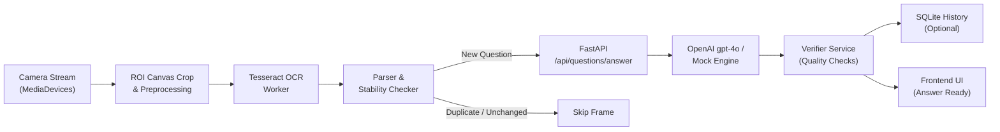

# VisionIQ AI
> **"See the Question. Understand the Answer."**

VisionIQ AI is a production-minded web application engineered for real-time camera-based question detection and multimodal AI answering. By pointing a smartphone or laptop camera at an external monitor, tablet, or physical test paper, VisionIQ AI automatically aligns the question, executes client-side optical character recognition (OCR), parses multiple-choice options, prevents duplicates, and displays verified AI-generated answers with step-by-step reasoning.

---

## 1. Key Features

- **Real-Time Camera Integration:** Direct hardware camera access using HTML5 MediaDevices API with automatic rear/front camera switching and graceful permission error handling.
- **Client-Side Edge OCR & Preprocessing:** Dynamic Region of Interest (ROI) cropping with canvas contrast stretching, luminance normalization, and Tesseract.js Web Workers.
- **Autonomous Automatic Question Detection:** State machine with stability verification (`QUESTION_STABILITY_CHECKS=2`), Sørensen–Dice similarity duplicate rejection (`DUPLICATE_SIMILARITY_THRESHOLD=0.88`), and automatic transition handling without requiring manual taps.
- **Multimodal AI Reasoning Engine:** Powered by FastAPI and OpenAI's `gpt-4o` / `gpt-4o-mini`, with strict Pydantic schemas, math verification heuristics, option existence validation, and fallback deterministic mock reasoning for local testing without paid keys.
- **Stale Request & Race Condition Protection:** `AbortController` request cancellation ensures newer detected questions supersede in-flight API requests, preventing stale responses from overwriting active answers.
- **Manual Correction & Vision AI Fallback:** One-click manual correction modal for editing misread characters, plus a dedicated vision snapshot button to submit complex graphical questions directly to OpenAI Vision API.
- **History & Settings:** Persistent SQLite question history with complete export and delete controls, configurable scan frequency slider (800ms – 3000ms), and sound chimes synthesized via the Web Audio API.

---

## 2. Architecture & Pipeline



---

## 3. Technology Stack

- **Frontend:** React 18, Vite 5, Tailwind CSS, Lucide React, Tesseract.js
- **Backend:** Python 3.11+, FastAPI, Pydantic v2, Uvicorn, SQLAlchemy (Asyncio), aiosqlite, OpenAI Python SDK
- **Testing:** Pytest & pytest-asyncio (Backend), Vitest (Frontend)
- **Deployment:** Vercel (Frontend), Render / Docker (Backend)

---

## 4. Project Structure

```
visioniq-ai/
├── backend/
│   ├── app/
│   │   ├── api/
│   │   │   ├── history.py          # GET/DELETE /api/history
│   │   │   └── routes.py           # /api/health, /api/questions/answer, /api/questions/answer-image, /api/questions/verify
│   │   ├── core/
│   │   │   └── config.py           # Pydantic Settings & environment variables
│   │   ├── database/
│   │   │   ├── database.py         # Async SQLAlchemy engine & session factory
│   │   │   └── models.py           # Question history SQLite ORM model
│   │   ├── schemas/
│   │   │   └── question.py         # Pydantic request & response models
│   │   ├── services/
│   │   │   ├── ai_service.py       # OpenAI multimodal integration + intelligent mock engine
│   │   │   └── verifier_service.py # Deterministic math sanity & option presence checker
│   │   └── main.py                 # FastAPI application & CORS configuration
│   ├── tests/
│   │   ├── conftest.py             # Async test database fixture
│   │   ├── test_answer.py          # MCQ, math, open-ended, and validation tests
│   │   ├── test_health.py          # Health check and credentials security tests
│   │   ├── test_history.py         # History write, read, and delete tests
│   │   ├── test_verify.py          # Math calculation and option boundary tests
│   │   └── test_vision.py          # Image upload size and MIME type tests
│   ├── Dockerfile                  # Container deployment specification
│   ├── Procfile                    # Process entrypoint for PaaS
│   ├── requirements.txt            # Python dependencies
│   ├── .env.example                # Backend configuration template
│   └── .env                        # Local development variables
├── frontend/
│   ├── src/
│   │   ├── components/
│   │   │   ├── AlignmentOverlay.jsx      # Laser scan animation & reticle guide
│   │   │   ├── AnswerPanel.jsx           # Formatted answer, option badge, and explanation
│   │   │   ├── CameraPanel.jsx           # Live video stream, controls, and status badges
│   │   │   ├── Header.jsx                # Navigation, branding, and connectivity badges
│   │   │   ├── ManualCorrectionModal.jsx # Manual edit interface for OCR typos
│   │   │   ├── QuestionPanel.jsx         # Extracted question & interactive MCQ choices
│   │   │   └── StatusBadge.jsx           # State machine visualization badge
│   │   ├── hooks/
│   │   │   ├── useCamera.js              # MediaDevices lifecycle & camera flipping
│   │   │   ├── useQuestionDetector.js    # Automatic detection, debounce, and stability state machine
│   │   │   └── useSettings.js            # User preferences with localStorage sync
│   │   ├── pages/
│   │   │   ├── AboutPage.jsx             # Privacy notice, architecture, and ethical use
│   │   │   ├── Dashboard.jsx             # Main responsive 2-column view
│   │   │   ├── HistoryPage.jsx           # Past question session browser
│   │   │   └── SettingsPage.jsx          # Frequency slider, audio, and language toggles
│   │   ├── services/
│   │   │   ├── api.js                    # Fetch client with AbortSignal cancellation
│   │   │   ├── imagePreprocessing.js     # Canvas ROI cropping, contrast stretch, grayscale
│   │   │   └── ocrService.js             # Tesseract.js worker singleton
│   │   ├── utils/
│   │   │   ├── questionParser.js         # Text normalization and MCQ regex extraction
│   │   │   ├── sound.js                  # Web Audio synthesizer chimes
│   │   │   └── textSimilarity.js         # Sørensen–Dice duplicate detector
│   │   ├── App.jsx                       # Root React component
│   │   ├── index.css                     # Tailwind custom styling & scrollbars
│   │   └── main.jsx                      # DOM mount point
│   ├── tests/
│   │   ├── questionParser.test.js        # Parser unit tests
│   │   └── textSimilarity.test.js        # Similarity & duplicate prevention unit tests
│   ├── package.json
│   ├── postcss.config.js
│   ├── tailwind.config.js
│   ├── vercel.json                       # Single-page app routing for Vercel
│   ├── vite.config.js
│   ├── .env.example
│   └── .env
├── render.yaml                           # Blueprint for Render deployment
├── pytest.ini                            # Pytest configuration
├── .gitignore
└── README.md
```

---

## 5. Prerequisites

- **Python:** 3.10 or later
- **Node.js:** 18 or later
- **npm:** 9 or later

---

## 6. Local Setup and Installation

### A. Clone and Setup Environment

```bash
# Clone the repository
git clone <repository_url>
cd visioniq-ai

# Set up Python virtual environment
python -m venv venv

# Activate virtual environment
# On Windows (PowerShell):
.\venv\Scripts\Activate.ps1
# On macOS/Linux:
source venv/bin/activate
```

### B. Backend Installation

```bash
# Install dependencies
pip install -r backend/requirements.txt

# Configure environment
cp backend/.env.example backend/.env
```

*(Edit `backend/.env` with your `OPENAI_API_KEY`. If left empty, the system automatically uses the intelligent Mock Reasoning Engine for local testing without incurring API fees.)*

### C. Frontend Installation

```bash
cd frontend
npm install
cp .env.example .env
cd ..
```

---

## 7. Running the Application Locally

### Start Backend Server

```bash
# From workspace root with venv activated
uvicorn backend.app.main:app --host 127.0.0.1 --port 8000 --reload
```
- API Base: `http://127.0.0.1:8000`
- Interactive Swagger Documentation: `http://127.0.0.1:8000/docs`

### Start Frontend Client

```bash
# In a separate terminal
cd frontend
npm run dev
```
- Web Application: `http://localhost:5173`

---

## 8. Automated Testing

### Running Backend Tests (Pytest)

The backend test suite covers the health endpoint, request validation, MCQ solving, deterministic arithmetic verification, SQLite history persistence and deletion, and vision file-size validation:

```bash
# Run all backend tests
pytest -v backend/tests
```

*All 12 backend tests pass with zero external paid API requirements.*

### Running Frontend Tests (Vitest)

The frontend test suite validates OCR text parsing, multiline question extraction, MCQ option tokenization, Sørensen–Dice similarity scoring, and duplicate detection:

```bash
cd frontend
npm test
```

*All 9 frontend unit tests pass.*

---

## 9. Environment Variables

### Backend (`backend/.env`)

| Variable | Description | Default |
|---|---|---|
| `OPENAI_API_KEY` | Official OpenAI API Key (leave blank for Mock Engine) | `""` |
| `OPENAI_MODEL` | Target multimodal model | `gpt-4o` |
| `FRONTEND_ORIGIN` | Allowed CORS origin for production | `http://localhost:5173` |
| `DATABASE_URL` | SQLite async database path | `sqlite+aiosqlite:///./visioniq.db` |
| `ENABLE_HISTORY_BY_DEFAULT` | Automatically persist answered questions | `true` |
| `REQUEST_TIMEOUT_SECONDS` | Maximum timeout for upstream AI responses | `25.0` |
| `MAX_IMAGE_SIZE_MB` | Maximum allowed image payload size | `10` |

### Frontend (`frontend/.env`)

| Variable | Description | Default |
|---|---|---|
| `VITE_API_BASE_URL` | Base URL of the FastAPI backend server | `http://localhost:8000` |

---

## 10. Deployment Instructions

### Deploying the Backend to Render

1. Create a new Web Service on [Render](https://render.com).
2. Connect your Git repository.
3. Configure the following build & start settings:
   - **Environment:** `Python`
   - **Build Command:** `pip install -r backend/requirements.txt`
   - **Start Command:** `uvicorn backend.app.main:app --host 0.0.0.0 --port $PORT`
4. In the Render Environment Variables tab, configure:
   - `OPENAI_API_KEY`: `your_production_openai_api_key`
   - `OPENAI_MODEL`: `gpt-4o`
   - `FRONTEND_ORIGIN`: `https://your-frontend.vercel.app`
   - `DATABASE_URL`: `sqlite+aiosqlite:///./visioniq.db`
   - `PYTHONPATH`: `.`

*(Alternatively, connect the provided [render.yaml](file:///c:/Users/ACER/Desktop/best_bit/render.yaml) Blueprint in Render for 1-click deployment).*

### Deploying the Frontend to Vercel

1. Import your Git repository into [Vercel](https://vercel.com).
2. Configure project settings:
   - **Framework Preset:** `Vite`
   - **Root Directory:** `frontend`
   - **Build Command:** `npm run build`
   - **Output Directory:** `dist`
3. Add Environment Variable:
   - `VITE_API_BASE_URL`: `https://your-backend-service.onrender.com`
4. Click **Deploy**. The included [vercel.json](file:///c:/Users/ACER/Desktop/best_bit/frontend/vercel.json) ensures proper SPA client-side routing.

---

## 11. Privacy, Security, and Ethical Use

- **No Covert Surveillance:** The app strictly requires explicit user camera permission via the browser prompt and displays clear visual indicators while active.
- **Edge-First Processing:** Image frames are processed locally inside the user's browser canvas and Tesseract worker. Frames are never uploaded to the backend server unless the user explicitly triggers the Vision AI snapshot.
- **Credential Protection:** API keys remain strictly on the Python backend and are never sent to or visible in client-side bundles.
- **System Quality Indicators:** The confidence labels (`High confidence`, `Needs verification`, `Question unclear`) reflect automated system checks (option presence, deterministic arithmetic verification, OCR completeness) and are never misrepresented as guaranteed correctness.
- **Authorized Academic Use:** VisionIQ AI is built for interactive study, accessibility, and authorized exam revision.

---

## 12. Known Limitations

- **Screen Glare and Moire Patterns:** When pointing phone cameras at low-refresh-rate external monitors, moire scan lines can occasionally distort character recognition. The built-in contrast stretch filter mitigates this, but holding the camera steady and perpendicular yields the best results.
- **Complex Diagrammatic Questions:** Pure optical character recognition cannot interpret geometric diagrams or schematics without text. For diagram-heavy questions, the **"Vision AI Solve"** button should be used to send the frame directly to `gpt-4o`'s vision API.
