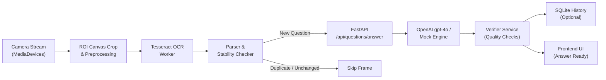

# VisionIQ AI
> **"See the Question. Understand the Answer."**

VisionIQ AI is an edge-first, multimodal web application engineered for real-time camera-based question detection and AI-assisted answering. By pointing a smartphone or laptop camera at an external monitor, tablet, or physical test paper, VisionIQ AI dynamically crops the region of interest, executes client-side optical character recognition (OCR), parses multiple-choice options, rejects duplicates with string similarity algorithms, and displays verified AI-generated answers with step-by-step reasoning.

---

## 1. Live Deployments

| Component | Platform | Status | Verified URL / Dashboard Reference |
|---|---|---|---|
| **Backend API** | [Render](https://render.com) (`visioniq-ai-backend`) | **Live** | `https://visioniq-ai-backend.onrender.com` |
| **Backend Health Check** | Render Web Service | **Verified 200 OK** | `https://visioniq-ai-backend.onrender.com/api/health` |
| **Frontend Client** | [Vercel](https://vercel.com) | **Deployed to Production** | Deployed Vercel Production Domain (from Vercel Project Dashboard) |
| **Source Code** | GitHub | **Synchronized** | [loges-waran/visioniq-ai](https://github.com/loges-waran/visioniq-ai) |

> [!NOTE]
> The backend health check endpoint `/api/health` is fully operational and verified live. It returns service status, active AI engine status, model configuration, and database health without exposing any credentials or secrets.

---

## 2. Key Features

- **Real-Time Camera Integration:** Direct hardware camera access using HTML5 MediaDevices API with automatic rear/front camera switching and graceful permission error handling.
- **Client-Side Edge OCR & Preprocessing:** Dynamic Region of Interest (ROI) cropping with canvas contrast stretching, luminance normalization, and Tesseract.js Web Workers running entirely client-side.
- **Autonomous Question Detection:** State machine with stability verification (`QUESTION_STABILITY_CHECKS=2`), Sørensen–Dice similarity duplicate rejection (`DUPLICATE_SIMILARITY_THRESHOLD=0.88`), and automatic transition handling without requiring manual taps.
- **Multimodal AI Reasoning Engine:** Powered by FastAPI and OpenAI's `gpt-4o` / `gpt-4o-mini`, with strict Pydantic schemas, math verification heuristics, option existence validation, and fallback deterministic mock reasoning for local testing without paid keys.
- **Stale Request & Race Condition Protection:** `AbortController` request cancellation ensures newer detected questions supersede in-flight API requests, preventing stale responses from overwriting active answers.
- **Manual Correction & Vision AI Fallback:** One-click manual correction modal for editing misread characters, plus a dedicated vision snapshot button to submit complex graphical questions directly to OpenAI Vision API.
- **History & Settings:** Persistent SQLite question history with complete export and delete controls, configurable scan frequency slider (800ms – 3000ms), and sound chimes synthesized via the Web Audio API.

---

## 3. Architecture & Pipeline



---

## 4. Technology Stack

- **Frontend:** React 18, Vite 5, Tailwind CSS, Lucide React, Tesseract.js
- **Backend:** Python 3.11+, FastAPI, Pydantic v2, Uvicorn, SQLAlchemy (Asyncio), aiosqlite, OpenAI Python SDK
- **Testing:** Pytest & pytest-asyncio (Backend), Vitest (Frontend)
- **Deployment & Hosting:**
  - **Frontend:** Vercel (Single-Page App rewrites via `vercel.json`)
  - **Backend:** Render (`render.yaml` Blueprint or Python Web Service)
  - **Containerization:** Docker (`backend/Dockerfile`)

---

## 5. Project Structure

```
visioniq-ai/
├── backend/
│   ├── app/
│   │   ├── api/
│   │   │   ├── history.py          # GET/DELETE /api/history
│   │   │   └── routes.py           # /api/health, /api/questions/answer, /api/questions/answer-image, /api/questions/verify
│   │   ├── core/
│   │   │   └── config.py           # Pydantic Settings & environment variables
│   │   ├── database/
│   │   │   ├── database.py         # Async SQLAlchemy engine & session factory
│   │   │   └── models.py           # Question history SQLite ORM model
│   │   ├── schemas/
│   │   │   └── question.py         # Pydantic request & response models
│   │   ├── services/
│   │   │   ├── ai_service.py       # OpenAI multimodal integration + intelligent mock engine
│   │   │   └── verifier_service.py # Deterministic math sanity & option presence checker
│   │   └── main.py                 # FastAPI application & CORS configuration
│   ├── tests/
│   │   ├── conftest.py             # Async test database fixture
│   │   ├── test_answer.py          # MCQ, math, open-ended, and validation tests
│   │   ├── test_health.py          # Health check and credentials security tests
│   │   ├── test_history.py         # History write, read, and delete tests
│   │   ├── test_verify.py          # Math calculation and option boundary tests
│   │   └── test_vision.py          # Image upload size and MIME type tests
│   ├── Dockerfile                  # Container deployment specification
│   ├── Procfile                    # Process entrypoint for PaaS
│   ├── requirements.txt            # Python dependencies
│   ├── .env.example                # Backend configuration template
│   └── .env                        # Local development variables (git-ignored)
├── frontend/
│   ├── src/
│   │   ├── components/
│   │   │   ├── AlignmentOverlay.jsx      # Laser scan animation & reticle guide
│   │   │   ├── AnswerPanel.jsx           # Formatted answer, option badge, and explanation
│   │   │   ├── CameraPanel.jsx           # Live video stream, controls, and status badges
│   │   │   ├── Header.jsx                # Navigation, branding, and connectivity badges
│   │   │   ├── ManualCorrectionModal.jsx # Manual edit interface for OCR typos
│   │   │   ├── QuestionPanel.jsx         # Extracted question & interactive MCQ choices
│   │   │   └── StatusBadge.jsx           # State machine visualization badge
│   │   ├── hooks/
│   │   │   ├── useCamera.js              # MediaDevices lifecycle & camera flipping
│   │   │   ├── useQuestionDetector.js    # Automatic detection, debounce, and stability state machine
│   │   │   └── useSettings.js            # User preferences with localStorage sync
│   │   ├── pages/
│   │   │   ├── AboutPage.jsx             # Privacy notice, architecture, and ethical use
│   │   │   ├── Dashboard.jsx             # Main responsive 2-column view
│   │   │   ├── HistoryPage.jsx           # Past question session browser
│   │   │   └── SettingsPage.jsx          # Frequency slider, audio, and language toggles
│   │   ├── services/
│   │   │   ├── api.js                    # Fetch client with AbortSignal cancellation
│   │   │   ├── imagePreprocessing.js     # Canvas ROI cropping, contrast stretch, grayscale
│   │   │   └── ocrService.js             # Tesseract.js worker singleton
│   │   ├── utils/
│   │   │   ├── questionParser.js         # Text normalization and MCQ regex extraction
│   │   │   └── textSimilarity.js         # Sørensen–Dice duplicate detector
│   │   ├── App.jsx                       # Root React component
│   │   ├── index.css                     # Tailwind custom styling & scrollbars
│   │   └── main.jsx                      # DOM mount point
│   ├── tests/
│   │   ├── questionParser.test.js        # Parser unit tests
│   │   └── textSimilarity.test.js        # Similarity & duplicate prevention unit tests
│   ├── package.json
│   ├── postcss.config.js
│   ├── tailwind.config.js
│   ├── vercel.json                       # Single-page app routing for Vercel
│   ├── vite.config.js
│   ├── .env.example                      # Frontend environment template
│   └── .env                              # Local development variables (git-ignored)
├── render.yaml                           # Blueprint for Render deployment
├── pytest.ini                            # Pytest configuration
├── .gitignore                            # Secrets & build artifact ignore list
└── README.md
```

---

## 6. Local Setup and Installation

### Prerequisites

- **Python:** 3.10+
- **Node.js:** 18+
- **npm:** 9+

### A. Clone and Setup Environment

```bash
# Clone the repository
git clone https://github.com/loges-waran/visioniq-ai.git
cd visioniq-ai

# Set up Python virtual environment
python -m venv venv

# Activate virtual environment
# Windows (PowerShell):
.\venv\Scripts\Activate.ps1
# macOS/Linux:
source venv/bin/activate
```

### B. Backend Installation

```bash
# Install dependencies
pip install -r backend/requirements.txt

# Configure environment
cp backend/.env.example backend/.env
```

*(Edit `backend/.env` with your `OPENAI_API_KEY`. If left empty, the system automatically uses the intelligent Mock Reasoning Engine for local testing without incurring API fees.)*

### C. Frontend Installation

```bash
cd frontend
npm install
cp .env.example .env
cd ..
```

---

## 7. Running Locally

### Start Backend Server

```bash
# From workspace root with venv activated
uvicorn backend.app.main:app --host 127.0.0.1 --port 8000 --reload
```
- API Base: `http://127.0.0.1:8000`
- Verified Health Endpoint: `http://127.0.0.1:8000/api/health`
- Interactive Swagger Documentation: `http://127.0.0.1:8000/docs`

### Start Frontend Client

```bash
# In a separate terminal
cd frontend
npm run dev
```
- Web Application: `http://localhost:5173`

---

## 8. Automated Testing

### Backend Unit & Integration Tests (Pytest)

The backend test suite covers the health endpoint, request validation, MCQ solving, deterministic arithmetic verification, SQLite history persistence and deletion, and vision file-size validation:

```bash
pytest -v backend/tests
```

*All 12 backend tests pass with zero external paid API requirements.*

### Frontend Unit Tests (Vitest)

The frontend test suite validates OCR text parsing, multiline question extraction, MCQ option tokenization, Sørensen–Dice similarity scoring, and duplicate detection:

```bash
cd frontend
npm test
```

*All 9 frontend unit tests pass.*

---

## 9. Environment Variables and Configuration

### Backend Configuration (`backend/.env` or Render Environment)

| Variable | Description | Default / Example |
|---|---|---|
| `OPENAI_API_KEY` | Official OpenAI API Key (leave empty for deterministic mock mode) | `""` |
| `OPENAI_MODEL` | Target multimodal model | `gpt-4o` |
| `FRONTEND_ORIGIN` | Allowed CORS origin for production (must match Vercel URL) | `https://<your-vercel-domain>.vercel.app` |
| `DATABASE_URL` | SQLite async database path | `sqlite+aiosqlite:///./visioniq.db` |
| `ENABLE_HISTORY_BY_DEFAULT` | Automatically persist answered questions | `true` |
| `REQUEST_TIMEOUT_SECONDS` | Maximum timeout for upstream AI responses | `25.0` |
| `MAX_IMAGE_SIZE_MB` | Maximum allowed image payload size | `10` |
| `PYTHONPATH` | Python import root | `.` |

### Frontend Configuration (`frontend/.env` or Vercel Environment)

| Variable | Description | Production Value |
|---|---|---|
| `VITE_API_BASE_URL` | Base URL of the deployed FastAPI backend | `https://visioniq-ai-backend.onrender.com` |

---

## 10. Production Deployment Guide

### A. Backend on Render (`visioniq-ai-backend`)

The backend is hosted as a Web Service on Render:

1. **Service Type:** Web Service
2. **Environment:** Python
3. **Region:** Oregon (or closest to your users)
4. **Plan:** Free
5. **Build Command:**
   ```bash
   pip install -r backend/requirements.txt
   ```
6. **Start Command:**
   ```bash
   uvicorn backend.app.main:app --host 0.0.0.0 --port $PORT
   ```
7. **Environment Variables:**
   - `PYTHONPATH`: `.`
   - `OPENAI_API_KEY`: *(Your OpenAI API key, or omitted for mock mode)*
   - `OPENAI_MODEL`: `gpt-4o`
   - `FRONTEND_ORIGIN`: Set to your deployed Vercel domain (see section below)
   - `DATABASE_URL`: `sqlite+aiosqlite:///./visioniq.db`
   - `ENABLE_HISTORY_BY_DEFAULT`: `true`

*(Alternatively, connecting the root [render.yaml](render.yaml) Blueprint in Render automatically provisions this service with matching specifications).*

### B. Frontend on Vercel

The frontend is deployed to Production on Vercel:

1. **Framework Preset:** `Vite`
2. **Root Directory:** `frontend`
3. **Build Command:** `npm run build`
4. **Output Directory:** `dist`
5. **Environment Variables:**
   - `VITE_API_BASE_URL`: `https://visioniq-ai-backend.onrender.com`
6. **Single-Page Application Routing:**
   Vercel uses the included [frontend/vercel.json](frontend/vercel.json) rewrite rule so client-side routes (`/history`, `/settings`, `/about`) load properly on direct navigation and page refreshes:
   ```json
   {
     "rewrites": [
       {
         "source": "/(.*)",
         "destination": "/index.html"
       }
     ]
   }
   ```

---

## 11. Configuring Backend `FRONTEND_ORIGIN` (CORS Binding)

For security, the FastAPI backend restricts Cross-Origin Resource Sharing (CORS) to designated origins. To ensure the Vercel frontend can communicate with the Render backend without CORS errors:

1. Copy your live production URL from your **Vercel Project Dashboard** (e.g. `https://visioniq-ai-<unique-id>.vercel.app` or your custom domain).
2. Go to your **Render Dashboard** > select **`visioniq-ai-backend`** > **Environment**.
3. Set or update the `FRONTEND_ORIGIN` variable to your exact Vercel frontend URL:
   ```env
   FRONTEND_ORIGIN=https://<your-vercel-domain>.vercel.app
   ```
   > [!IMPORTANT]
   > Do not include a trailing slash in the origin URL (use `https://example.vercel.app`, not `https://example.vercel.app/`).
4. Click **Save Changes**. Render will automatically restart the backend service with the updated CORS policy.

---

## 12. Deployment Verification & Troubleshooting

### Verifying Backend Health

Verify that the backend is live and answering queries using the `/api/health` endpoint:

```bash
# Test live backend health
curl -s https://visioniq-ai-backend.onrender.com/api/health
```

Expected JSON response:
```json
{
  "status": "healthy",
  "ai_configured": false,
  "model": "gpt-4o",
  "history_enabled": true,
  "version": "1.0.0"
}
```
*(Note: `ai_configured` will report `true` when a valid `OPENAI_API_KEY` is configured in Render environment variables).*

### Troubleshooting Checklist

1. **Render Cold Starts (Free Tier):**
   - Render's free tier spins down inactive web services after 15 minutes of idle time.
   - When opening the application after inactivity, the first API request may experience a 30–50 second delay while the container boots. Subsequent requests respond instantly.
2. **CORS Error (`Access to fetch at ... has been blocked by CORS policy`):**
   - Check the browser developer console (F12 > Console).
   - Ensure the backend's `FRONTEND_ORIGIN` on Render exactly matches the protocol and domain in the browser address bar.
3. **Camera Hardware Permission (`NotAllowedError` / `NotFoundError`):**
   - Modern browsers require HTTPS to grant camera access (`navigator.mediaDevices.getUserMedia`).
   - Both Vercel and Render enforce HTTPS with automated SSL certificates, ensuring camera permissions work on mobile and desktop.
   - If denied, check browser site settings to reset the camera permission prompt.
4. **Frontend API Connection Failure:**
   - In your Vercel Project Settings > Environment Variables, confirm that `VITE_API_BASE_URL` is configured to `https://visioniq-ai-backend.onrender.com`.
   - Remember that Vite environment variables are embedded at build time; after modifying `VITE_API_BASE_URL`, trigger a redeploy in Vercel.

---

## 13. Privacy, Security, and Ethical Use

- **No Secrets Committed:** API keys, database files, and local `.env` files are strictly excluded via `.gitignore`.
- **Edge-First OCR:** OCR frames are processed locally inside the client's browser canvas using WebAssembly and Web Workers. Camera frames are never sent to the server unless the user explicitly triggers Vision AI analysis.
- **Backend Credential Isolation:** The client never receives or stores OpenAI API keys. All upstream AI interactions are authenticated server-side.
- **Health Endpoint Security:** The verified `/api/health` route confirms service and database status without leaking tokens, environment variables, or database paths.
- **Academic Integrity:** VisionIQ AI is designed for assisted study, visual question-answering accessibility, and authorized exam revision.

---

## 14. Known Limitations

- **Screen Glare and Moire Patterns:** Pointing phone cameras at low-refresh-rate external monitors can produce moire interference. The built-in contrast stretch filter mitigates this, but holding the camera steady and perpendicular yields the best OCR precision.
- **Complex Diagrams & Schematics:** Plain text OCR cannot interpret geometric drawings or circuit diagrams. For diagram-heavy problems, use the **"Vision AI Solve"** button to send the frame directly to `gpt-4o` vision analysis.
